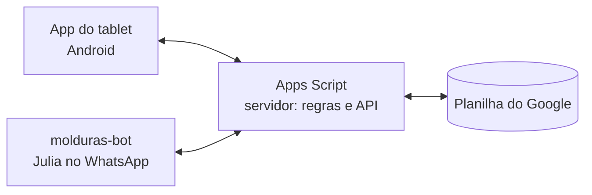

# Estoque Molduraria

Controle de estoque, orçamento, oficina e financeiro de uma molduraria de verdade, a Vera Molduras e Decoração, em Paranavaí (PR).

A ideia é simples: a equipe trabalha num app Android no tablet da loja, uma planilha do Google guarda tudo e o Google Apps Script faz o papel de servidor entre os dois. Do outro lado, a Julia, atendente virtual do WhatsApp, consulta esse mesmo servidor pra responder os clientes.

## Como funciona



**O app é onde a equipe trabalha.** Feito com Expo e React Native, ele roda no tablet do balcão e cobre o dia a dia da loja:

- **Orçamento** com vários quadros por cliente, paspatur, vidro duplo e reforma. Avisa na hora quando a moldura não vai dar. Salvar o orçamento não mexe no estoque; só o "Fechou a venda" desconta, e o que faltar vai pra lista de compras.
- **Depósito** com o mapa da loja: 5 corredores e 2 paredes, 87 casinhas. Tocando numa casinha você vê as molduras que estão nela e quantas varas tem. Buscando uma moldura, o app abre o corredor e a casinha dela pisca.
- **Oficina** com as ordens em produção, no acabamento e prontas.
- **Pra comprar**, separado por fornecedor e pronto pra mandar no WhatsApp.
- **Financeiro** protegido por senha.

O app funciona mesmo com a internet ruim: guarda o que foi feito numa fila e manda pra planilha quando a conexão volta.

**O Apps Script é o servidor.** Nem o app nem a Julia escrevem direto na planilha: tudo passa por ele, que calcula, confere e grava. É ali que mora a conta do orçamento e a baixa do estoque, então o tablet e o WhatsApp sempre chegam no mesmo valor. A conta do orçamento é copiada do servidor pro app por um script (`scripts/gerar-nucleo-app.js`), pra o tablet calcular igual mesmo sem internet.

**A planilha é o banco de dados.** Cada assunto tem a sua aba: molduras, vidros e chapas, vendas, orçamentos, ordens da oficina, entradas e saídas do caixa. Dá pra abrir e conferir tudo no próprio Google Sheets.

## Ligação com o molduras-bot

A Julia, que atende os clientes no WhatsApp, fica no repositório [molduras-bot](https://github.com/GuilhermeZaros/molduras-bot). Ela não tem banco próprio: tudo que ela sabe sobre as molduras vem da API deste projeto.

- Quando o cliente pergunta por uma moldura ou pede um orçamento, a Julia chama `buscarMolduras`, `listarMateriais`, `consultarProduto` e `calcularOrcamento`. Assim ela só oferece o que tem em estoque e o preço sai da mesma conta que a loja usa.
- Quando a oficina marca um quadro como pronto, a Julia percebe na próxima consulta a `oficinaPendentes` (ela olha de minuto em minuto), avisa o cliente no WhatsApp e confirma o aviso com `oficinaConfirmarAviso`.

Os dois projetos só conversam pela URL do Web App. Um não importa código do outro, então dá pra mexer em um sem quebrar o outro, desde que a API continue respondendo do mesmo jeito.

## Regras de negócio

- Moldura é cobrada pelo perímetro (metro linear). Vidro, chapa e espelho, pela área (m²).
- Com paspatur o quadro inteiro cresce: moldura, vidro e chapa são calculados no tamanho de fora (foto mais duas vezes a borda).
- A baixa da moldura usa o consumo real na vara de 2,70 m: perímetro, cantos, a perda dos cortes em 45° e a da serra. O cliente continua pagando pelo perímetro.
- O estoque nunca fica negativo. Se a venda fecha sem moldura suficiente, a falta vira encomenda na lista de compras.

## O que tem em cada pasta

| Pasta | O que tem |
|---|---|
| `app-tablet/` | O app Android do tablet (Expo SDK 58) |
| `apps-script/` | O servidor: regras, API e acesso à planilha (versionado com [clasp](https://github.com/google/clasp)) |
| `scripts/` | Utilitários: `gerar-nucleo-app.js` copia as contas do Apps Script pro app, pra o tablet calcular igual à planilha; `gerar-catalogo.js` e `gerar-fotos.js` montam o catálogo; `conferir-app-leitura.mjs` testa a API sem gravar nada |
| `test/` | Testes do Apps Script rodando em Node |
| `exemplos/` | Modelo do arquivo com os dados da loja |

## Como rodar

```bash
npm test
```

O app do tablet tem um modo de demonstração que não precisa da planilha. Crie `app-tablet/.env.local` com `EXPO_PUBLIC_API_URL=demo` e rode:

```bash
cd app-tablet
npm install
npm test
npm run web
```

Pra ligar na sua própria planilha:

1. Copie `.clasp.exemplo.json` para `.clasp.json` e coloque o ID do seu script e da sua planilha.
2. Copie `exemplos/DadosDaLoja.gs` para `apps-script/` e troque pelos seus dados.
3. Rode `clasp push` e publique o Web App.
4. No app, `EXPO_PUBLIC_API_URL` recebe a URL `/exec` e `EXPO_PUBLIC_APP_TOKEN` a senha criada pelo menu da planilha.

## O que fica de fora

Os dados reais da loja (caixa, custos dos fornecedores, e-mail, IDs da planilha) e as chaves de acesso ficam só no computador da loja. No repositório vão apenas o código e linhas de exemplo.
